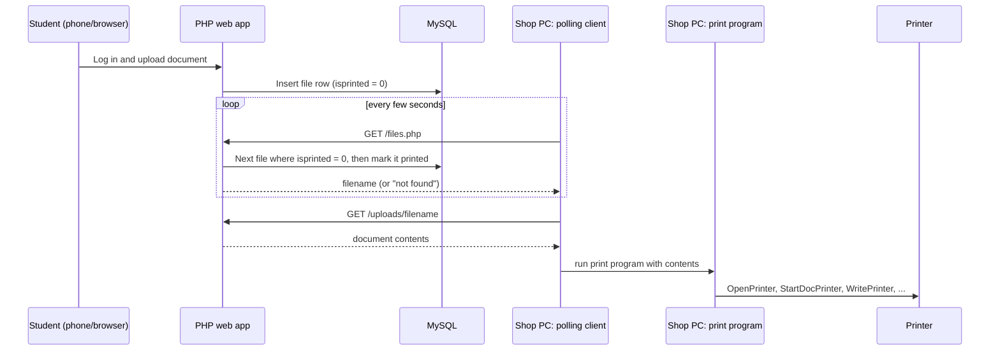

<div class="row justify-content-center">
  <div class="col-sm-8 mt-3 mt-md-0">
    
  </div>
</div>

**Savitribai Phule Pune University, 2018** · with Subhasish Chatterjee and Himaja Gogineni · [Source on GitHub](https://github.com/Shubhamd13/POTG)

This was our own idea. We built it as our third-year project for the Database Management Systems course.

## The idea

Getting something printed at the college photocopy shop meant standing in a queue while the operator opened each file and clicked Print. Prints On The Go removes that step: a student uploads a document from anywhere, and a small program on the shop's computer picks it up and sends it to the printer on its own. Nobody has to click Print and there is no print dialog, print agent, or third-party tool involved.

## How it works

The system has three parts:

1. **Web app (PHP + MySQL).** Students register, log in, upload documents, and can rename or delete their account.
2. **Polling client (C + libcurl).** Runs on the shop's Windows PC. Every few seconds it asks the server for the next unprinted file, downloads it from the server's upload directory, and hands it to the print program.
3. **Print program (C++ + Win32 spooler API).** Opens the printer by name and writes the document straight into the Windows print spooler.



## Database design

Since we built this for a DBMS course, the schema did more than store data:

- **`print`** holds users, keyed by phone number.
- **`files`** holds each uploaded document's name, size, MIME type, and an `isprinted` flag. That flag doubles as the print queue: the server hands out the next row with `isprinted = 0` and flips it to `1`.
- **`uploads`** links users to their files, with foreign keys declared `ON DELETE CASCADE` on both sides. Deleting an account cleans up that user's uploads automatically.

## The hard part: printing with nobody at the keyboard

Printing from an application on Windows usually goes through a print dialog where a person picks the printer and clicks OK. To skip that, I went below the usual application layer to the Windows print spooler API (`winspool.h`, documented under Microsoft's GDI printing docs). Getting a page out of a real printer this way, with no human in the loop, took most of the effort in the project.

The print program drives the spooler directly:

```cpp
DOC_INFO_1 doc;
doc.pDocName    = (LPTSTR)"Somefile.txt";
doc.pOutputFile = (LPTSTR)"";      // print to the device, not a file
doc.pDatatype   = (LPTSTR)"raw";   // bytes go to the printer as-is

OpenPrinter("HP LaserJet P1008", &print_handle, NULL);
StartDocPrinter(print_handle, 1, reinterpret_cast<unsigned char *>(&doc));
StartPagePrinter(print_handle);
WritePrinter(print_handle, (PVOID)s.c_str(), s.length(), &written);
EndPagePrinter(print_handle);
EndDocPrinter(print_handle);
ClosePrinter(print_handle);
```

The `RAW` datatype tells the spooler not to render anything, so the bytes go to the printer exactly as written. The upside is that no driver UI ever appears. The downside is that the program has to speak the printer's language itself. The built-in test page, for example, starts with `\033E`, the PCL printer-reset escape sequence.

## Looking back

- **Text only.** The polling client passes a document's contents to the print program as command-line arguments, so the prototype handled plain-text files. Printing PDFs or images would mean rendering pages through a GDI device context, or handing files to an application that can render them.
- **Polling instead of push.** Asking the server every few seconds was simple and needed no open port on the shop PC. But the server marks a job as printed the moment it hands out the name, so a failed download loses that job. A proper job queue with acknowledgements would fix that.

## References

1. [Print Spooler API](https://learn.microsoft.com/en-us/windows/win32/printdocs/print-spooler-api), Microsoft Learn: [OpenPrinter](https://learn.microsoft.com/en-us/windows/win32/printdocs/openprinter), [StartDocPrinter](https://learn.microsoft.com/en-us/windows/win32/printdocs/startdocprinter), and [WritePrinter](https://learn.microsoft.com/en-us/windows/win32/printdocs/writeprinter).
2. [libcurl easy interface](https://curl.se/libcurl/c/libcurl-easy.html), used by the polling client.
